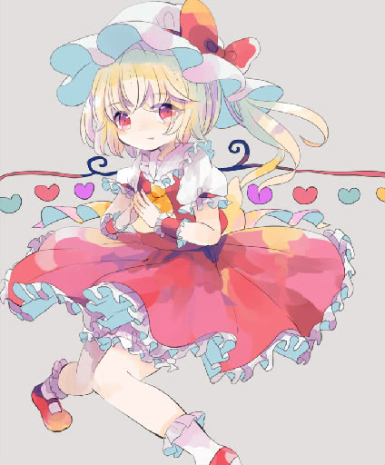
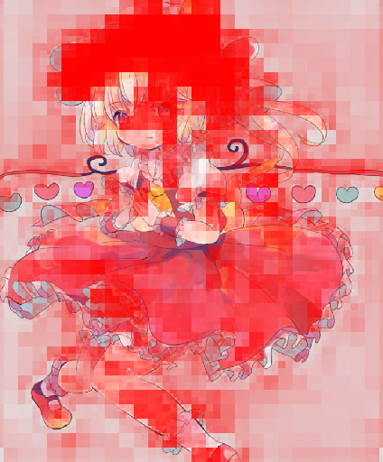
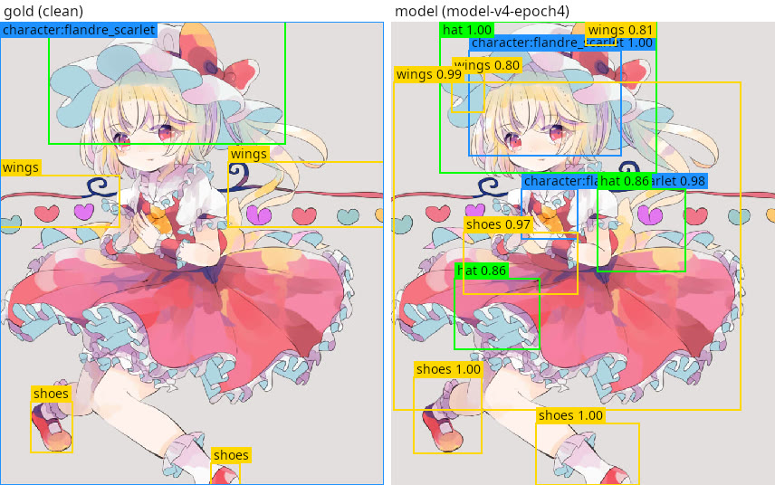

# unbooru-tagger

An anime and booru-style image tagger. For an image, it gives you:

- **tags with confidences** over a vocabulary of thousands of booru tags (characters, series, artists, clothing,
  objects, ratings, ...);
- **a heatmap** for any tag, showing where in the image the evidence for it is;
- **approximate bounding boxes** for tags that have a place in the image (gloves, hats, earrings, characters);
- **a content rating** (general / sensitive / questionable / explicit).

Tags are rows in a learned embedding table, not outputs of a fixed classifier head. **A new tag can be added
later by training only its own row,** without retraining the model. The localization needs no box annotations:
the heatmaps come from the same image-tag similarity that produces the scores.

The whole project is C#/.NET. Training uses [TorchSharp](https://github.com/dotnet/TorchSharp); inference uses
ONNX Runtime, from one command-line tool. There is no Python in the repository.

### Example

Run 4's epoch-4 model on one image from the hand-checked gold set. The gold set mostly overlaps run 4's training
split, so this shows what the output looks like, not held-out accuracy. Artwork by **hiyuu (hiyualice)**
([Danbooru post 6776791](https://danbooru.donmai.us/posts/6776791)).

<p>
  
  
</p>

`tag` output (the top 24 of the 55 tags it reports; each tag uses its own calibrated threshold):

```
rating  General
0.995   series:touhou               0.896   red_eyes                    0.787   frills
0.995   character:flandre_scarlet   0.896   mob_cap                     0.782   socks
0.993   1girl                       0.843   puffy_short_sleeves         0.772   puffy_sleeves
0.983   solo                        0.838   heart                       0.759   one_side_up
0.981   hat                         0.837   shoes                       0.752   neckwear
0.975   blonde_hair                 0.829   ascot                       0.747   red_shoes
0.904   wings                       0.804   white_hat                   0.747   grey_background
0.897   short_sleeves               0.801   looking_at_viewer           0.745   simple_background
```

Right of the image above: the heatmap for `hat` (`heatmap`). Below: the gold boxes (left) and the model's boxes for
the same tags (right, `render-gold --png`). The boxes are approximate. Here the shoes are found, the hat's box
covers the hat and the face, and the wings, which are thin and spread across the image, get one large box.



## Contents

- [What it does](#what-it-does)
- [Requirements for running](#requirements-for-running)
- [Install](#install)
- [The model bundle](#the-model-bundle)
- [Commands](#commands)
- [Runtime options: devices and batching](#runtime-options-devices-and-batching)
- [How it compares](#how-it-compares)
- [Training your own model](#training-your-own-model)
- [Research](#research)
- [Repository layout](#repository-layout)

## What it does

- **Tagging.** Each tag's confidence is `sigmoid(scale * dot(image embedding, tag embedding) + bias)`.
  - A tag is reported when it clears its own threshold, calibrated on held-out images (`tag_thresholds.json`), or
    the `--threshold` you pass.
  - Of any two mutually exclusive tags (`solo` vs `multiple_girls`), only the stronger is reported.
- **Heatmaps.** The same dot product at every location of the model's spatial feature map. For the current
  models that is a 128x128 map for a 512px input.
- **Boxes.** These are approximate localization, not a trained detector.
  - Connected regions of a tag's heatmap become boxes after a per-tag percentile cut and an edge-aware filter that
    snaps the heatmap to the image's own edges.
  - Specks below a minimum size are dropped, and each tag keeps at most 3 boxes by default.
  - Whole-image tags (artist, series, style, background, medium, framing, people counts, rating) are reported
    without boxes.
- **Adding tags.** A new tag gets a new embedding row, trained on its images with the image encoder frozen. See
  [docs/TRAINING.md](docs/TRAINING.md#adding-a-tag).

Accuracy and localization are still being improved. The current numbers, the protocol behind them and their
caveats are in [research/](research/README.md).

## Requirements for running

| | Minimum | Notes |
|---|---|---|
| **OS** | Linux with the .NET 10 SDK | Linux is what the project runs on. Other operating systems that .NET 10 and ONNX Runtime support should work but aren't tested. |
| **CPU** | Any x64 CPU that runs .NET 10 | No minimum measured. CPU inference works; it is the fallback. |
| **GPU** | None required | Optional NVIDIA GPU with a CUDA 12 runtime and cuDNN 9 that ONNX Runtime can load. Intel GPUs are not supported for inference: they are used for training only. |
| **RAM** | Not measured | The current model's bundle is about 147 MB on disk (114 MB image encoder, 38 MB tag embeddings). |
| **Disk** | The bundle, plus your images | |

**Measured speed.** The only recorded inference timing is `render-gold` over 289 images: about 25 s on an NVIDIA
RTX A4000 against about 2 minutes on the CPU. That covers decoding, encoding and box extraction, at batch size 16.

## Install

You need the **.NET 10 SDK**. [`global.json`](global.json) allows newer majors and prereleases.

```sh
git clone https://github.com/da3dsoul/unbooru-tagger.git
cd unbooru-tagger
dotnet build unbooru-tagger-inference -c Release
```

The inference tool doesn't need anything else from this repository's data or training projects, and doesn't need
the sibling `unbooru` repository.

### Running on an NVIDIA GPU (CUDA)

The core references `Microsoft.ML.OnnxRuntime.Gpu` 1.24.2, the newest build against **CUDA 12**; 1.25 and later
need CUDA 13. It contains the CPU provider too.

- With a CUDA 12 runtime and cuDNN 9 installed where ONNX Runtime can load them, the batch commands use GPU 0 by
  default (`--device Auto`).
- Without them, the batch commands run on the CPU.
- `--device Cuda` fails instead of falling back.

### CPU only

Nothing extra is needed. The single-image commands (`tag`, `detect`, `heatmap`) always run on the CPU. The batch
commands fall back to the CPU when CUDA can't load, or when you pass `--device Cpu`.

## The model bundle

Every command takes `--model-dir` (default `./model`), a directory written by the training CLI's `export-onnx`:

```
model/
  image_encoder.onnx     # the image tower; outputs pooled and spatial features (and localization features)
  tag_vocabulary.json    # the tags, by row
  tag_embeddings.bin     # one embedding row per tag
  logit_scaling.json     # learned scale/bias; missing = Scale 1, Bias 0 (older exports)
  tag_thresholds.json    # optional: per-tag calibrated thresholds
  exclusive_tags.txt     # optional: mutually exclusive tag groups
  localizable_tags.txt   # optional: which tags get boxes; built-in defaults if missing
```

- **Input size:** read from the ONNX graph; the current models use 512px.
- **Letterboxing:** non-square images are letterboxed, never stretched, and the padding is left out of pooling,
  heatmaps and box coordinates.
- **Older bundles still load:**
  - bundles exported before batching run one image at a time;
  - bundles without a separate localization output draw heatmaps from the full map.

**Where to get a bundle:**

- Train one: see [docs/TRAINING.md](docs/TRAINING.md).
- Or download one from the [Releases](https://github.com/da3dsoul/unbooru-tagger/releases) page, if one is
  published there. No bundle has been published yet (2026-11-04); the current model is run 4 at epoch 4.

Model files are never committed to git.

## Commands

Run any command with `dotnet run --project unbooru-tagger-inference -c Release -- <command> ...`, or run the built
`unbooru-tagger-inference` executable directly.

### `tag`: tag one image

```sh
unbooru-tagger-inference tag ./image.png --model-dir ./model [--threshold 0.4]
```

Prints `rating<TAB><rating>` first, if the model was trained with ratings. Then it prints one
`confidence<TAB>tag` line per reported tag, most confident first.

### `tag-batch`: tag a directory

```sh
unbooru-tagger-inference tag-batch ./images --model-dir ./model > tags.json
```

- Prints one JSON object: `{ "file.png": { "tag": confidence, ... }, ... }`.
- Takes `--threshold`, `--batch-size`, `--workers` and `--device`.
- An image that can't be decoded is reported and skipped, and the command exits 1 at the end.

### `detect`: tags and boxes for one image

```sh
unbooru-tagger-inference detect ./image.png --model-dir ./model [--out detected.png]
```

- Prints the detections as JSON to stdout.
- `--out` also writes the image with colored, labelled boxes.
- Each box is labelled with its own peak confidence, not the tag's whole-image score.

### `detect-batch`: tags and boxes for a directory, in one pass

```sh
unbooru-tagger-inference detect-batch ./images --model-dir ./model --out results.jsonl [--recursive] [--render-dir ./rendered]
```

Writes one JSON line per image, in completion order:

```json
{"image": "<path relative to the directory>", "rating": ..., "tags": [{"tag": ..., "confidence": ..., "boxes": [{"x": ..., "y": ..., "width": ..., "height": ..., "confidence": ...}]}]}
```

- One model run per image gives both the tags and the boxes.
- `--recursive` includes subdirectories.
- `--render-dir` also writes each image with its boxes drawn.
- `--no-boxes` skips heatmaps and boxes.
- Takes the box options below, and `--batch-size`, `--workers` and `--device`.

### `heatmap`: where one tag is

```sh
unbooru-tagger-inference heatmap ./image.png gloves --model-dir ./model --out gloves_heatmap.png
```

Writes the heatmap overlaid on the image.

### `render-gold`: compare with hand-checked boxes

For anyone with a gold set in the project's `gold.json` format; see
[research/datasets-and-evaluation.md](research/datasets-and-evaluation.md#the-gold-set-gold):

```sh
unbooru-tagger-inference render-gold ./gold/gold.json --out-dir ./gold/renders --model-dir ./model
```

- **With a model:** writes `boxes.json` (per gold image, the model's tags, confidences and boxes), for an
  interactive comparison page.
  - `--png` also writes side-by-side PNGs: the gold boxes next to the model's.
  - `--all-tags` shows every detected tag, not only the gold ones.
  - `--min-confidence F` keeps the gold tags down to `F`, for a page with a live cutoff.
  - `--scores` takes per-pair scores from a training-side evaluation dump.
- **Without a model:** draws the gold boxes alone.

### Options shared by the commands

| Option | Default | Commands | Meaning |
|---|---|---|---|
| `--model-dir` | `./model` | all | The model bundle. |
| `--threshold` | the tag's calibrated threshold, else 0.5 | tag, tag-batch, detect, detect-batch, render-gold | Minimum confidence to report a tag. |
| `--box-threshold` | 0.5 | detect, detect-batch, render-gold | Minimum per-cell confidence for a cell to join a box. |
| `--box-percentile` | 0.6 | same | Also cut within each tag's own heatmap range (0 = its weakest cell, 1 = only its peak), to tighten boxes. |
| `--min-heatmap-range` | 0.05 | same | No boxes for a tag whose heatmap is flatter than this. |
| `--min-box-fraction` | 0.002 | same | Drop regions smaller than this fraction of the map. |
| `--max-boxes-per-tag` | 3 | same | Keep the strongest N boxes per tag; 0 = all. |
| `--batch-size` | 16 | tag-batch, detect-batch, render-gold | Images per model run. |
| `--workers` | 0 (half the logical CPUs) | tag-batch, detect-batch | Threads for decoding, and for per-image scoring and boxes. |
| `--device` | `Auto` | tag-batch, detect-batch, render-gold | `Auto` (CUDA GPU 0 if it loads, else CPU), `Cuda` or `Cpu`. |

## Runtime options: devices and batching

- **Pipeline.** The batch commands run a pipeline: decoding and letterboxing on `--workers` threads, batched
  encoding (`--batch-size` images per ONNX run), and per-image scoring and box extraction, connected by bounded
  queues. The model never waits on decoding, and memory stays flat.
- **Batching.** The exported graph has a symbolic batch dimension. Every op works per image, and a test checks
  batched results against single images.
- **GPU.** `--device Auto` uses ONNX Runtime's CUDA provider on GPU 0 when it loads, and the CPU otherwise.
- **Thresholds.** If the bundle has `tag_thresholds.json`, each tag uses its calibrated threshold unless you pass
  `--threshold`. Uncalibrated tags use 0.5.

## How it compares

> **Stub.** A comparison with other taggers (fixed-head booru taggers such as the WD14 tagger and DeepDanbooru,
> JoyTag, CLIP/SigLIP-style scoring) and with open-vocabulary detectors (OWLv2, Grounding DINO, SAM 3) is being
> prepared. Accuracy and performance data are still being updated.

The design differences are already clear:

- tags can be added later by training one row, without retraining;
- localization and boxes come without box labels;
- in the maintainer's experience it is much faster to train. Head-to-head figures are still to be measured.

The current model's own numbers (run 4, epoch 4, this project's protocol, not comparable to other projects' figures
without re-scoring):

| | |
|---|---|
| Held-out mAP (20,000 images, 10,945 tags) | 0.801; against each tag's hard negatives 0.862 |
| Gold pointing (heatmap peak in the hand-checked box) | 67.7%; small objects 37.4%, medium 60.5%, large 71.1%, characters 91.0% |
| Gold-auto pointing (SAM 3 boxes, 500 held-out images) | 65.9%; small objects 43.7% |
| Training | about 123 B70-hours for 4 epochs (an estimate) |

See [research/comparison.md](research/comparison.md).

## Training your own model

See **[docs/TRAINING.md](docs/TRAINING.md)**. It covers:

- hardware requirements (NVIDIA CUDA and Intel Arc XPU);
- crawling a dataset from Danbooru and Gelbooru;
- training and run 4's recipe;
- evaluation, the training dashboard and offloaded evaluations;
- exporting to ONNX and adding tags.

## Research

See **[research/](research/README.md)**. It covers:

- the project's goals and the history of its training runs;
- every experiment, with results, including the failures;
- the evaluation sets and how they were built;
- the mistakes made along the way;
- the papers referenced.

[`CLAUDE.md`](CLAUDE.md) holds the architecture rationale and the detailed experiment log.

## Repository layout

| Project | Purpose |
|---|---|
| `unbooru-tagger-core` | Model bundle loading, ONNX image encoding, vocabulary and embeddings, scoring, heatmaps and boxes, dataset formats. No TorchSharp dependency. |
| `unbooru-tagger-inference` | The inference CLI (this page). |
| `unbooru-tagger-training` | Training, evaluation, charts, ONNX export and `add-tag` (TorchSharp). |
| `unbooru-tagger-data-booru-downloader` | Crawls Danbooru and Gelbooru into a training dataset. |
| `unbooru-tagger-data-unbooru-import` | Builds datasets from an `unbooru` database; needs the sibling [`unbooru`](https://github.com/da3dsoul/unbooru) repository. |
| `unbooru-tagger-tests` | xUnit tests. |

## License

No license file is currently included in this repository.
