# Examples: heatmaps against hand-checked boxes

Twelve images from the hand-checked gold set, scored by run 4 at step 2.12M (`model-v4-s2.12M`, the first hours of
mixed-scale training). Left: the gold boxes (solid: certain, dashed: unsure, dotted: a group). Right: the model's heatmap
for each of the image's gold tags, drawn over the image. Every box is hand-drawn gold; the model's panel shows only its maps,
so compare the two side by side.

How to read them:

- **Each tag has its own hue**, the same in both panels, spread over the spectrum in name order. Where two tags' maps overlap,
  their hues mix by strength (blush over glasses reads yellow-green).
- **Opacity is the tag's evidence near its peak:** a cell is opaque at the tag's highest log-odds and clear 4 log-odds below
  it. This is the band `detect` now cuts its boxes from (see below).
- **+ marks each tag's peak.** Pointing (does the peak land in a gold box?) is the headline localization number in the
  research notes.

The gold set mostly overlaps run 4's training split, so these show what the output looks like, not held-out accuracy. They were
picked to cover small, medium and large objects, clean and messy images, and some failures. The same view, for every gold image
and every earlier model, is the compare page (`gold/compare.html`, outside git; built by `gold/tools/build_compare.py` from
`render-gold --heatmaps` output).

**Why heatmaps and not boxes.** Drawn this way, most maps peak on their objects; the boxes `detect` cut from them looked far worse.
It used to keep every cell above 60% of a tag's probability range, about a fifth of the image for every tag, an earring as much
as a coat. It now cuts 4 log-odds below each tag's peak (`--box-below-peak`): over the gold set's object tags, box precision
0.08 → 0.19, recall 0.12 → 0.25, and small objects found at all (0 → 0.11 / 0.14). Cutting 2 log-odds below the peak, 62% of a
medium object's region lies on the object, against 12% before. A further region now gets a box only if its own peak is within 1
log-odds of the tag's (`--box-peak-margin`): precision 0.27, recall 0.22. Boxes still read worse than the maps, since a map's extent
isn't its object's; the peak and the band are what to read.

---

### 1. Glasses, ears and a tail

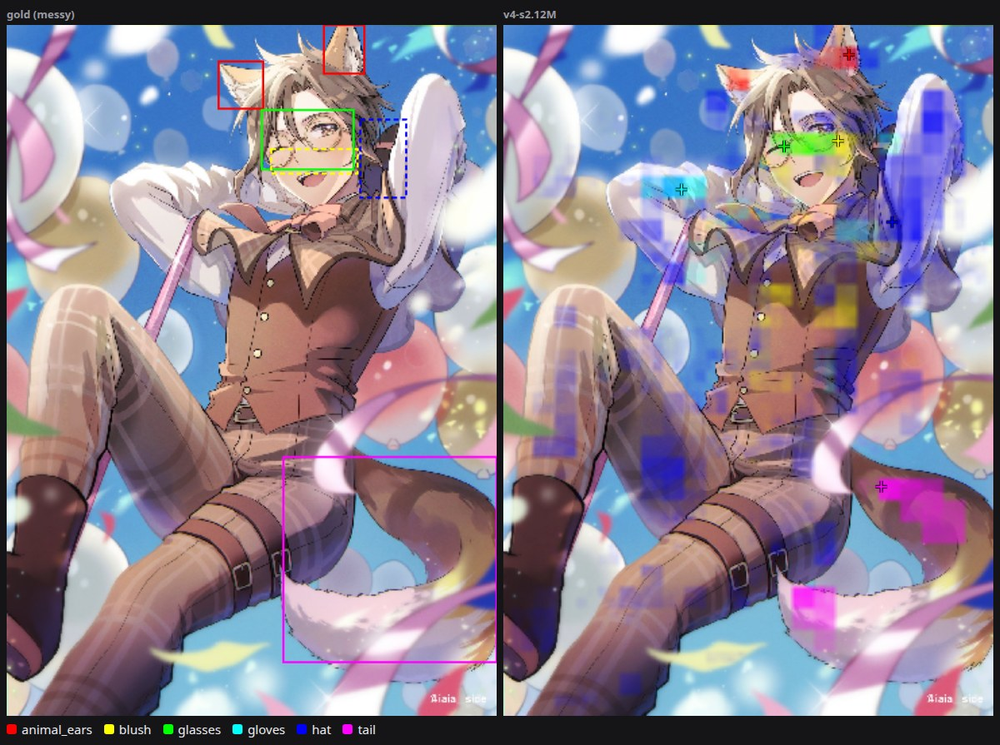

The glasses' region sits on the glasses and the tail's on the tail; the ears peak on one ear. The hat (an unsure box in the
gold set) spreads thinly over the upper body, and blush drifts onto the chest. [Danbooru post 8720188](https://danbooru.donmai.us/posts/8720188).

### 2. A wreath of chibi Mikus

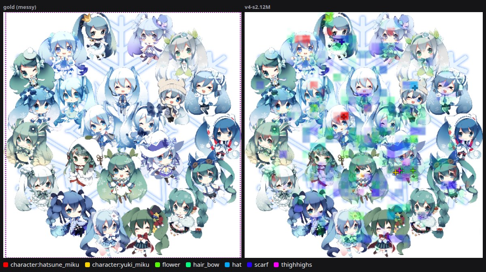

Twenty-odd figures, boxed as one group. The hat peaks on a hat and the flower on a flower, but each tag picks one instance;
scarf and thighhighs scatter. [Danbooru post 2067505](https://danbooru.donmai.us/posts/2067505).

### 3. Small objects on a clean image

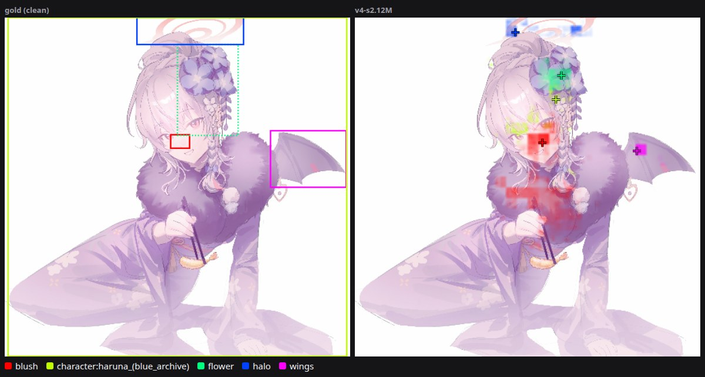

Flower, halo and wing each land on their object; blush sits on the cheeks and spills onto the fur collar.
[Danbooru post 9246455](https://danbooru.donmai.us/posts/9246455).

### 4. Two characters, six objects

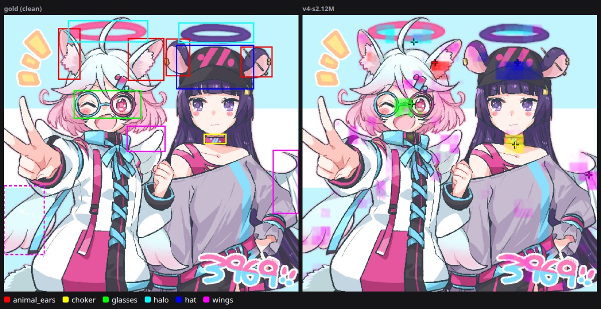

Glasses, choker and the cap land on their objects, the halo on one of the two halos, the animal ears on one ear. The wings,
mostly hidden behind the characters, get only faint scattered evidence. [Danbooru post 7846927](https://danbooru.donmai.us/posts/7846927).

### 5. Gloves, hat and tail

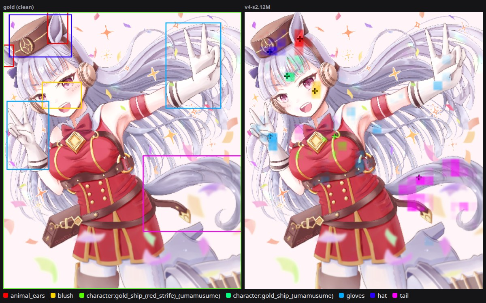

Hat, ears, tail and blush are in place. Gloves peak on the left glove; the raised right glove gets only faint cells.
[Danbooru post 11158604](https://danbooru.donmai.us/posts/11158604).

### 6. Halo, headphones, ears and tail

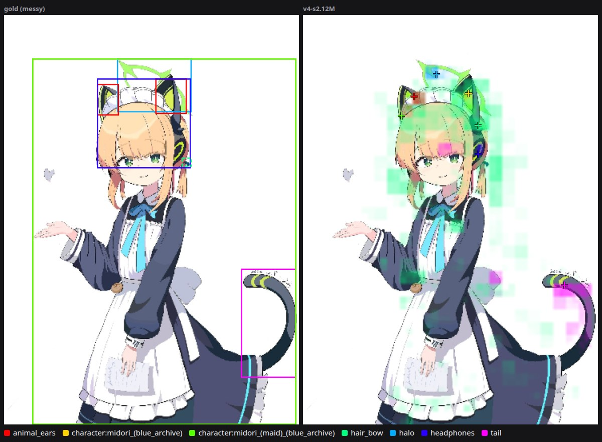

Each small object has its peak on it; hair_bow spreads over the head and dress instead of staying on the small bow. [Danbooru post 9362838](https://danbooru.donmai.us/posts/9362838).

### 7. A 17-pixel earring

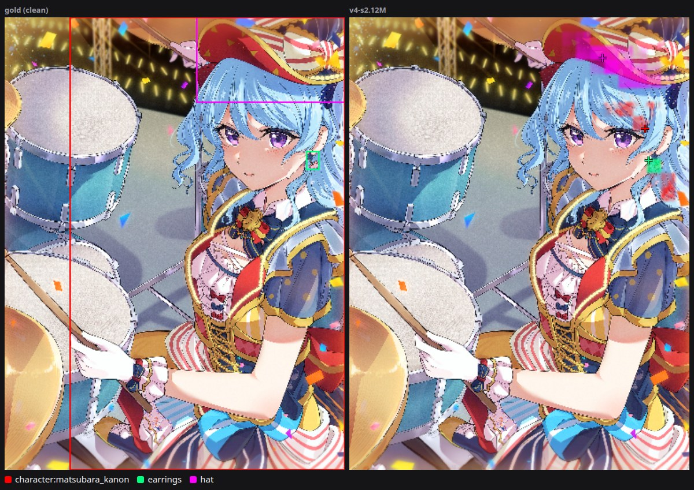

The earring is 17 px across at the model's 512 px input; its region and peak are on it. The hat covers the hat brim.
[Danbooru post 6371929](https://danbooru.donmai.us/posts/6371929).

### 8. Hairclips and a glove

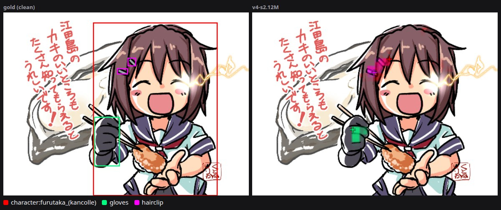

Both hairclips and the glove are found. [Danbooru post 8121740](https://danbooru.donmai.us/posts/8121740).

### 9. A chibi with a cup

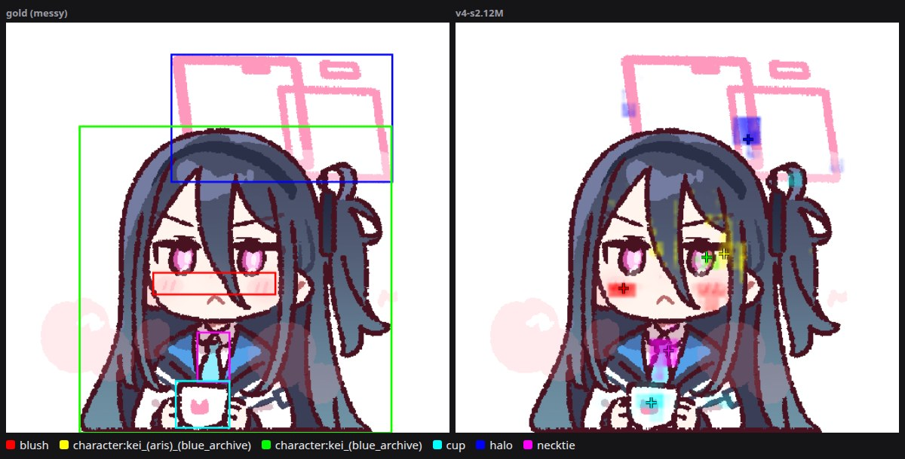

Cup, necktie and blush are on their objects; the halo (drawn as the phone-like frame above her head) peaks inside its box.
[Danbooru post 10250462](https://danbooru.donmai.us/posts/10250462).

### 10. Failure: thirty characters

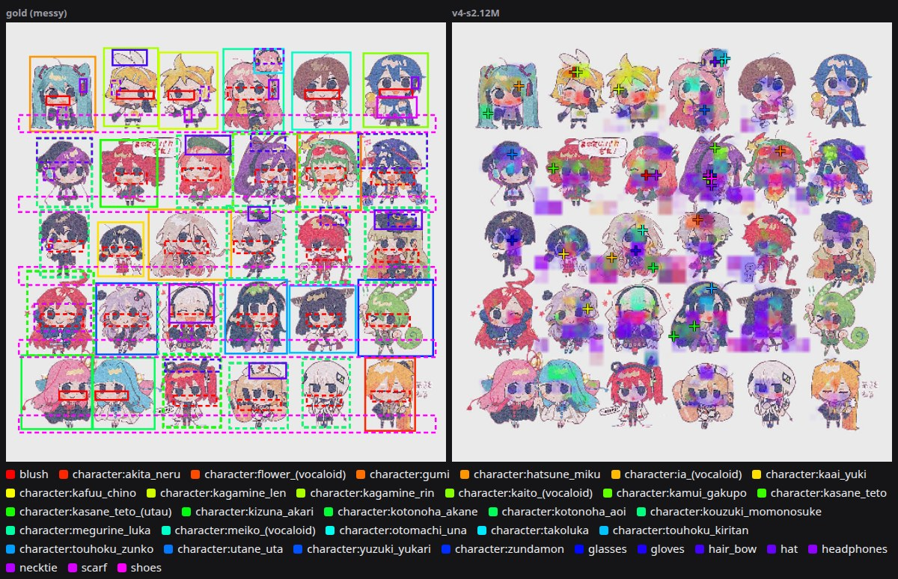

Thirty Vocaloid chibis and nine object tags. Many character peaks land on a character, not always the right one, and one hue
per tag can't keep forty tags apart. This kind of image is what the 2,048 px store and mixed-scale training are for.
[Danbooru post 9170460](https://danbooru.donmai.us/posts/9170460).

### 11. Failure: tiny figures

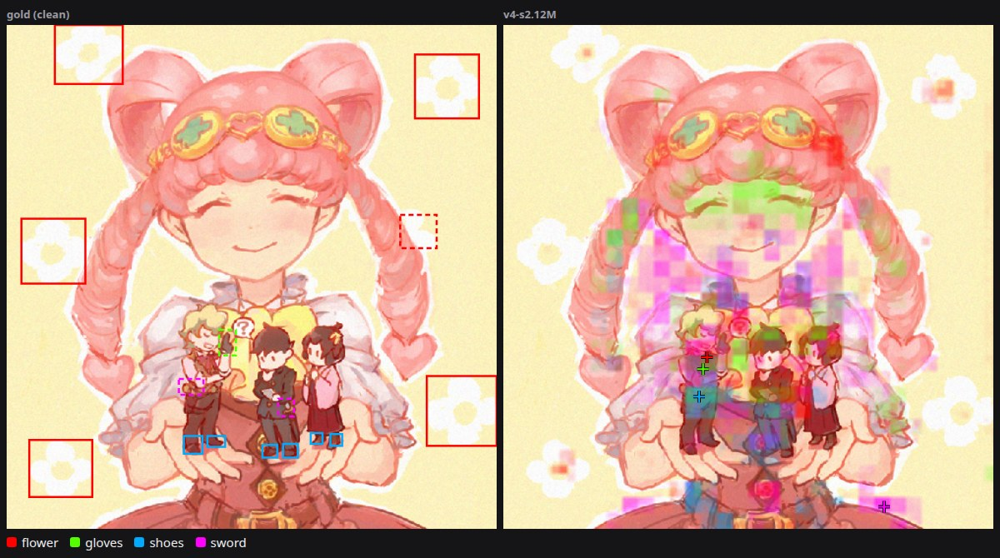

Three miniature people held in two hands. Shoes and gloves peak on the left figure, but their evidence spreads over the large
girl, the sword's is scattered, and the flowers (white shapes in the background) are missed.
[Danbooru post 7742835](https://danbooru.donmai.us/posts/7742835).

### 12. Partly right: a crowded scene

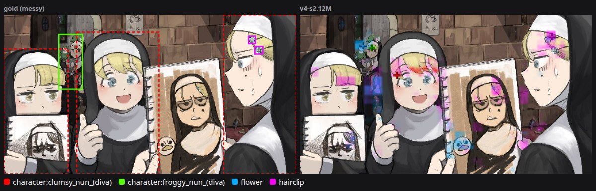

The hairclips' peak is on the hairclips and the flower's on a small flower in the background, but both spread across faces,
which is why this image scores low on region precision. [Danbooru post 4156752](https://danbooru.donmai.us/posts/4156752),
artwork by **diva (hyxpk)**.
